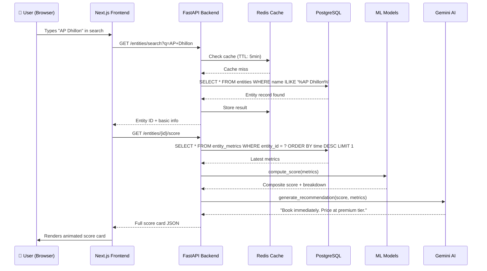
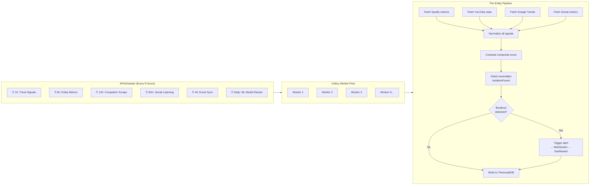
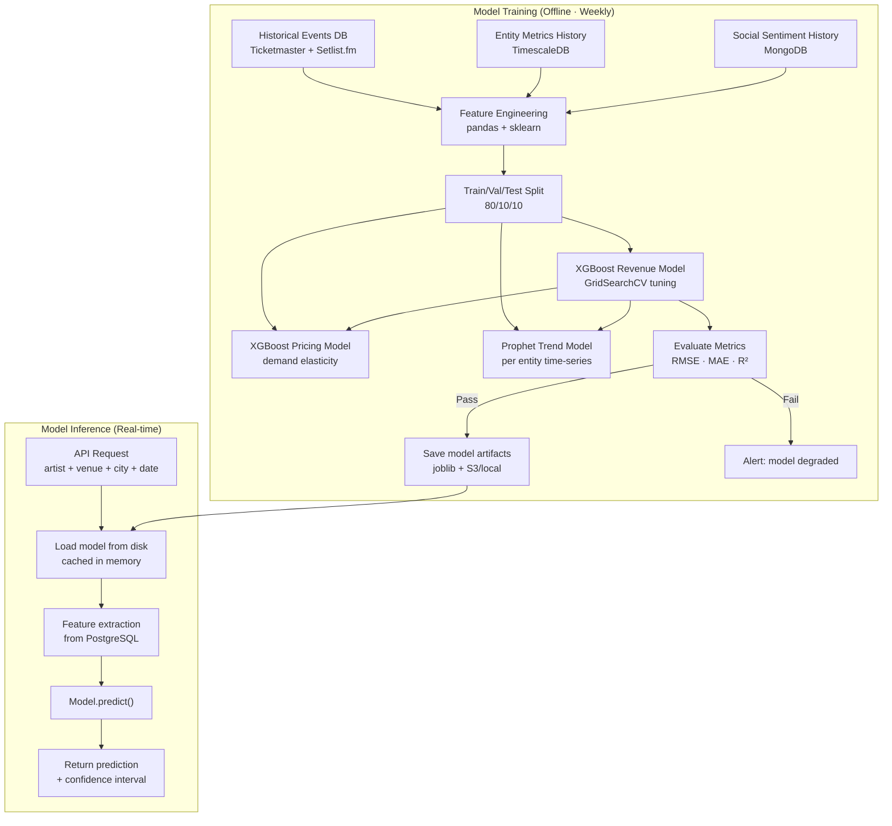
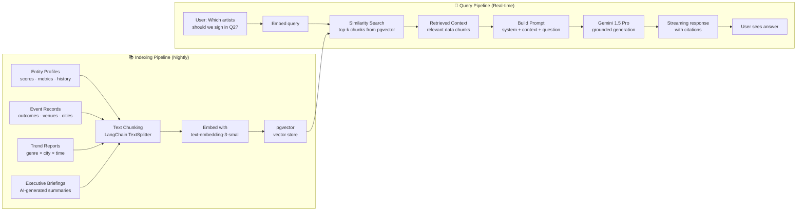

# 🏗️ LiveIQ — Complete Architecture & App Structure

---

## 1. Full System Architecture Diagram

```mermaid
graph TB
    subgraph EXTERNAL["🌐 External Data Sources"]
        direction LR
        SP["🎵 Spotify API<br/>listeners · popularity · audio features"]
        YT["▶️ YouTube Data API<br/>views · subscribers · comments"]
        GT["📈 Google Trends<br/>pytrends · city-level"]
        TM["🎟️ Ticketmaster API<br/>events · prices · venues"]
        BT["🎵 Bandsintown API<br/>RSVPs · tour dates"]
        SF["📅 Setlist.fm API<br/>concert history · cities"]
        LF["🎧 Last.fm API<br/>scrobbles · regional listeners"]
        EB["📋 Eventbrite API<br/>workshops · experiences"]
        TMDB["🎬 TMDB API<br/>movies · ratings · popularity"]
        CB["🏏 Cricbuzz / ESPN API<br/>sports · teams · matches"]
        WA["🌤️ Open-Meteo API<br/>weather · forecasts"]
        NA["📰 NewsAPI<br/>mentions · coverage"]
        RD["💬 Reddit API<br/>posts · comments · sentiment"]
        TW["🐦 Twitter/X API<br/>mentions · trends"]
        IG["📸 Instagram<br/>Graph API · followers"]
        GN["🎵 Genius API<br/>lyrics · artist bios"]
        FQ["📍 Foursquare API<br/>venues · nightlife"]
    end

    subgraph SCRAPERS["🕷️ Web Scraping Layer"]
        direction LR
        BMS_S["BookMyShow Scraper<br/>Playwright + BS4"]
        INS_S["Insider.in Scraper<br/>Playwright + BS4"]
        PAY_S["Paytm Events Scraper<br/>Playwright + BS4"]
        DIST_S["District.in Scraper<br/>Playwright + BS4"]
        BILL_S["Billboard India Scraper<br/>httpx + BS4"]
    end

    subgraph INGESTION["⚙️ Data Ingestion Layer"]
        direction TB
        CEL["🔄 Celery Workers<br/>APScheduler + Redis Broker"]
        subgraph WORKERS["Scheduled Workers"]
            W1["Artist Metrics Worker<br/>runs every 6h"]
            W2["Trend Signals Worker<br/>runs every 1h"]
            W3["Competitor Intel Worker<br/>runs every 12h"]
            W4["Social Listening Worker<br/>runs every 30min"]
            W5["Event Sync Worker<br/>runs every 4h"]
            W6["Movie/Sports Worker<br/>runs every 6h"]
        end
        CEL --> WORKERS
    end

    subgraph STORAGE["🗄️ Storage Layer"]
        direction TB
        PG["🐘 PostgreSQL + TimescaleDB<br/>entities · events · venues · cities<br/>time-series metrics · predictions"]
        MG["🍃 MongoDB<br/>raw social posts · news articles<br/>scraped HTML · unstructured data"]
        RD_C["⚡ Redis<br/>API cache · rate limit counters<br/>Celery broker · hot entity data"]
        ES["🔍 Elasticsearch<br/>full-text entity search<br/>aggregations · autocomplete"]
        PGV["🧠 pgvector<br/>semantic embeddings<br/>AI Copilot RAG index"]
    end

    subgraph ML_LAYER["🤖 ML / AI Layer"]
        direction TB
        subgraph SCRIPTS["⚡ Python Scripts (No ML)"]
            SC1["Entity Scorer v1<br/>weighted formula"]
            SC2["City Demand Ranker<br/>aggregation + sort"]
            SC3["Competitor Pattern Counter<br/>trend detection"]
            SC4["Conflict Detector<br/>date/city rules"]
        end
        subgraph MODELS["🧪 ML Models"]
            ML1["XGBoost Revenue Predictor<br/>event outcome regression"]
            ML2["XGBoost Price Optimizer<br/>demand elasticity model"]
            ML3["Prophet Trend Forecaster<br/>time-series prediction"]
            ML4["IsolationForest<br/>breakout anomaly detection"]
            ML5["DistilBERT Sentiment<br/>social NLP classifier"]
            ML6["VADER Sentiment<br/>fast rule-based NLP"]
            ML7["XGBoost Success Predictor<br/>sell-out classification"]
        end
        subgraph LLM_LAYER["🧠 LLM Layer"]
            GEM["Gemini 1.5 Pro<br/>narrative generation · executive AI"]
            RAG["LangChain RAG Pipeline<br/>pgvector retrieval · grounded QA"]
            GEM --> RAG
        end
    end

    subgraph API_LAYER["🚀 FastAPI Backend"]
        direction TB
        subgraph ROUTES["API Routes"]
            R1["GET /entities/search<br/>POST /entities/{id}/score"]
            R2["GET /trends/breakout<br/>GET /trends/genre/{city}"]
            R3["GET /cities/{id}/intelligence<br/>GET /cities/compare"]
            R4["POST /predict/event-success<br/>POST /predict/revenue"]
            R5["GET /competitors/intelligence<br/>GET /competitors/gaps"]
            R6["GET /recommend/entities<br/>POST /recommend/sign"]
            R7["GET /social/sentiment/{id}<br/>GET /social/topics"]
            R8["GET /pricing/optimize<br/>GET /pricing/elasticity"]
            R9["GET /executive/briefing<br/>GET /executive/kpis"]
            R10["POST /copilot/chat<br/>GET /copilot/sessions"]
        end
        WSOCK["🔌 WebSocket Server<br/>live metric updates"]
        AUTH["🔐 Auth Middleware<br/>JWT · OAuth2 · rate limiting"]
        CACHE_MW["📦 Cache Middleware<br/>Redis · response caching"]
    end

    subgraph FRONTEND["💻 Next.js 14 Frontend"]
        direction TB
        subgraph PAGES["App Sections"]
            P1["🏠 Home Dashboard<br/>KPIs · alerts · opportunities"]
            P2["🔍 Entity Intelligence<br/>search · score · profile"]
            P3["📈 Trend Radar<br/>breakout · genre momentum"]
            P4["🗺️ City Intelligence<br/>map · demand · comparison"]
            P5["💰 Revenue Simulator<br/>predictor · pricing tool"]
            P6["🕵️ Competitor Intel<br/>market gaps · trends"]
            P7["⭐ Recommendations<br/>ranking · ROI · sign list"]
            P8["💬 Social Listening<br/>sentiment · topics · alerts"]
            P9["📊 Executive Dashboard<br/>AI briefings · P&L"]
            P10["🤖 AI Copilot<br/>chat · NL analytics"]
            P11["📅 Events Manager<br/>portfolio · calendar"]
            P12["⚙️ Settings<br/>alerts · integrations · users"]
        end
        subgraph VIZ["Visualization Stack"]
            V1["ApexCharts<br/>line · bar · area · donut"]
            V2["Nivo<br/>radar · heatmap · treemap · bump"]
            V3["Mapbox GL<br/>India heatmap · venues"]
            V4["D3.js<br/>custom elasticity · wave charts"]
            V5["Framer Motion<br/>animations · transitions"]
        end
    end

    subgraph INFRA["🏗️ Infrastructure"]
        direction LR
        DK["🐳 Docker Compose<br/>all services containerized"]
        GH["⚙️ GitHub Actions<br/>CI/CD pipeline"]
        RW["🚂 Railway<br/>backend hosting"]
        VCL["▲ Vercel<br/>frontend hosting"]
        CF["☁️ Cloudflare<br/>CDN · DDoS protection"]
        GF["📊 Grafana + Prometheus<br/>metrics · monitoring"]
        ELK["📝 ELK Stack<br/>structured logging"]
    end

    %% Data Flow Connections
    EXTERNAL --> INGESTION
    SCRAPERS --> INGESTION
    INGESTION --> STORAGE
    STORAGE --> ML_LAYER
    ML_LAYER --> API_LAYER
    STORAGE --> API_LAYER
    API_LAYER --> FRONTEND
    INFRA -.->|hosts| API_LAYER
    INFRA -.->|hosts| FRONTEND
    INFRA -.->|monitors| STORAGE
```



---

## 2. Data Flow Diagram — Request Lifecycle



---

## 3. Background Data Collection Flow



---

## 4. ML Training & Inference Pipeline



---

## 5. AI Copilot (RAG) Architecture



---

## 6. App Sections — Complete Navigation Structure

```mermaid
graph TD
    ROOT["🏠 LiveIQ Dashboard"]

    ROOT --> NAV1["🏠 Home"]
    ROOT --> NAV2["🔍 Intelligence Hub"]
    ROOT --> NAV3["📈 Trends"]
    ROOT --> NAV4["🗺️ Markets"]
    ROOT --> NAV5["💰 Financials"]
    ROOT --> NAV6["🕵️ Competitors"]
    ROOT --> NAV7["📅 Events"]
    ROOT --> NAV8["💬 Listening"]
    ROOT --> NAV9["📊 Executive"]
    ROOT --> NAV10["🤖 AI Copilot"]
    ROOT --> NAV11["⚙️ Settings"]

    NAV1 --> H1["Live KPI Cards<br/>revenue · score · alerts"]
    NAV1 --> H2["Opportunity Feed<br/>AI-detected signals"]
    NAV1 --> H3["Activity Calendar<br/>upcoming events"]
    NAV1 --> H4["Quick Actions<br/>predict · search · compare"]

    NAV2 --> E1["Entity Search<br/>any artist/comedian/team/movie"]
    NAV2 --> E2["Entity Profile<br/>score card · radar · history"]
    NAV2 --> E3["Compare Entities<br/>side-by-side comparison"]
    NAV2 --> E4["Category Explorer<br/>browse by type"]

    NAV3 --> T1["Breakout Radar<br/>who will blow up next"]
    NAV3 --> T2["Genre Momentum<br/>rising vs falling genres"]
    NAV3 --> T3["Regional Trends<br/>city-level culture shifts"]
    NAV3 --> T4["Seasonal Patterns<br/>festival/holiday calendar"]

    NAV4 --> M1["India City Map<br/>demand heatmap by category"]
    NAV4 --> M2["City Intelligence Report<br/>full market breakdown"]
    NAV4 --> M3["City Comparison<br/>multi-city ranking"]
    NAV4 --> M4["Market Gap Finder<br/>demand with no supply"]

    NAV5 --> F1["Revenue Simulator<br/>entity + city + venue + date"]
    NAV5 --> F2["Pricing Optimizer<br/>ticket price recommendation"]
    NAV5 --> F3["ROI Calculator<br/>expected return on booking"]
    NAV5 --> F4["P&L Dashboard<br/>portfolio performance"]

    NAV6 --> C1["Competitor Overview<br/>BMS · Insider · Paytm"]
    NAV6 --> C2["Genre Market Share<br/>by platform by city"]
    NAV6 --> C3["Gap Analysis<br/>underserved categories"]
    NAV6 --> C4["Price Benchmarking<br/>our price vs theirs"]

    NAV7 --> EV1["Events Calendar<br/>all upcoming events"]
    NAV7 --> EV2["Event Creator<br/>run success prediction"]
    NAV7 --> EV3["Portfolio Tracker<br/>signed artists/events"]
    NAV7 --> EV4["Post-Event Analysis<br/>actual vs predicted"]

    NAV8 --> SL1["Sentiment Monitor<br/>real-time brand health"]
    NAV8 --> SL2["Topic Explorer<br/>what people are saying"]
    NAV8 --> SL3["Venue Feedback<br/>parking · sound · queues"]
    NAV8 --> SL4["Crisis Alerts<br/>negative spike detection"]

    NAV9 --> EX1["Daily AI Briefing<br/>what happened + why"]
    NAV9 --> EX2["Strategic Recommendations<br/>AI-generated actions"]
    NAV9 --> EX3["Business KPI Overview<br/>revenue · margin · growth"]
    NAV9 --> EX4["Export Reports<br/>PDF for stakeholders"]

    NAV10 --> AI1["Chat Interface<br/>any natural language question"]
    NAV10 --> AI2["Session History<br/>past Q&A stored"]
    NAV10 --> AI3["Saved Insights<br/>pin important answers"]
    NAV10 --> AI4["Suggested Queries<br/>pre-built question library"]
```



---

## 7. Detailed App Sections Breakdown

### Section 1 — 🏠 Home Dashboard
> The first thing any user sees. Must be stunning.

**Layout**: Top row KPI cards → Middle row (chart + opportunity feed) → Bottom row (calendar + AI alert)

**Components**:
| Component | Description | Visualization |
|-----------|-------------|--------------|
| KPI Strip | Revenue this month · Top trending entity · Events this week · Avg fill rate | Framer Motion number counters + trend arrow |
| Live Opportunity Feed | AI-detected signals: "Hanumankind trending +180% in Bangalore — no events listed" | Card list with urgency badges |
| Trending Now | Top 5 rising entities across all categories | Horizontal scroll cards with sparklines |
| Event Calendar | Heatmap of event density by date (GitHub-style) | D3 calendar heatmap |
| AI Alert Banner | "Revenue dropped 12% — monsoon + competition. Tap to read full report" | Dismissible banner with Gemini icon |
| City Activity Map | Mini India map showing hottest cities right now | Mapbox minimap embed |

---

### Section 2 — 🔍 Intelligence Hub
> Core feature. Works for ALL entity types.

**Sub-pages**:

**2a. Entity Search**
- Unified search across all 9 categories
- Autocomplete powered by Elasticsearch
- Filter chips: Music · Movies · Sports · Comedy · Theatre · Experiences · Workshops · Dining · Nightlife
- Results show entity type icon + current score + trend arrow

**2b. Entity Profile (The Hero Page)**
```
┌─────────────────────────────────────────────────────────────────┐
│ [Entity Image]  AP Dhillon                    [BOOK IMMEDIATELY] │
│                 Punjabi Pop / R&B · Canada    Score: 91 ↑        │
├─────────────────┬───────────────────────────────────────────────┤
│  SCORE RADAR    │   METRIC TREND LINE (90 days)                  │
│  (Nivo Radar)   │   Composite Score + Spotify + Social overlay   │
│  6-axis chart   │   (ApexCharts multi-line area)                 │
├─────────────────┴───────────────────────────────────────────────┤
│  Breakdown Cards (6 mini cards)                                  │
│  [Streaming 91] [Social 84] [Sentiment 82] [Demand 88] [Risk 12] │
├─────────────────────────────────────────────────────────────────┤
│  CITY DEMAND MAP (Mapbox heatmap — India)                        │
│  Mumbai 95% · Delhi 88% · Bangalore 81% · Ahmedabad 76%...      │
├─────────────────────────────────────────────────────────────────┤
│  SOCIAL SENTIMENT BREAKDOWN                                      │
│  Positive ████████████ 82%  Neutral ██ 9%  Negative ██ 9%       │
│  Top Topics: [Performance] [Lighting] [Setlist] [Parking ⚠️]    │
├─────────────────────────────────────────────────────────────────┤
│  COMPARABLE ENTITIES · SIMILAR ARTISTS  (horizontal cards)      │
│  Shubh · Karan Aujla · Diljit · Hanumankind                     │
└─────────────────────────────────────────────────────────────────┘
```

**2c. Compare Entities**
- Side-by-side comparison of 2–4 entities
- Overlaid radar charts
- Table diff: score, demand, risk, city performance
- "Who should we book?" AI conclusion at bottom

---

### Section 3 — 📈 Trend Radar
> The "million dollar product" module

**3a. Breakout Radar**
```
Top 10 Breakout Predictions — Next 90 Days
━━━━━━━━━━━━━━━━━━━━━━━━━━━━━━━━━━━━━━━━━━━━━━━━━━
#1 Karan Aujla    ██████████████░░ Score: 78→91 +17pts  89% confident
   Signals: Reels +340% · Google Trends breakout · Spotify saves +220%

#2 Seedhe Maut    ████████████░░░░ Score: 61→79 +18pts  84% confident
   Signals: Hip-hop demand surge Delhi · YouTube +180% · Reddit buzz
```
- Bump chart showing rank over time (Nivo BumpChart)
- Filter by category, city, time horizon
- "Why is this predicted?" expandable signal breakdown per entity

**3b. Genre Momentum Tracker**
- Treemap: Genre market size × momentum (Nivo Treemap)
- Color coding: green = growing, red = declining, yellow = stable
- Click genre → drill down to city-level view

**3c. Regional Culture Shifts**
- India map choropleth: which genre is dominant per city
- Time slider: watch genre dominance shift over 12 months

---

### Section 4 — 🗺️ City Intelligence (Markets)
> For geographic expansion decisions

**4a. India Demand Map**
- Full India Mapbox map
- Toggle heatmap by category (music / sports / comedy / etc.)
- Click city → side panel with city intelligence report
- Bubble size = event count, color intensity = demand score

**4b. City Intelligence Report**
```
Mumbai Market Intelligence
━━━━━━━━━━━━━━━━━━━━━━━━━━━━━━━━━━━━━━━
Tier: Metro · Population: 2.1Cr · Avg Income: ₹68,000/mo

Top Categories:         Music 34% · Dining 22% · Comedy 18%
Avg Ticket Price:       ₹2,800 (music) · ₹999 (comedy)
Events This Month:      142 (43 music, 28 comedy, 18 sports)
Fill Rate Avg:          78%
Best Days:              Fri/Sat (+34% vs weekday)
Risk Factors:           Monsoon Jun–Sep · IPL conflict windows
Underserved Now:        Hip-Hop (demand 89, supply 23)
```

**4c. Market Gap Finder**
- Matrix: Category × City → color = demand/supply ratio
- High demand + low supply = "OPPORTUNITY" badge
- Filterable, sortable table with action button

---

### Section 5 — 💰 Financials
> Where decisions become numbers

**5a. Revenue Simulator** (Most important tool for executives)
```
INPUT FORM (left panel)
├── Entity: [AP Dhillon ▼]
├── City: [Mumbai ▼]
├── Venue: [Nesco Exhibition Centre ▼]  (auto-suggests by capacity)
├── Date: [📅 March 15, 2025]
├── Day: Saturday (auto-detected)
├── Capacity: 10,000 (auto-filled from venue)
├── Ticket Tiers:
│   GA Floor:  [₹3,200]
│   Seated:    [₹5,500]
│   VIP:       [₹12,000]
│   VIP %:     [5%]

RESULTS (right panel - updates live as you type)
├── Expected Attendance: 9,600 (96%)
├── Gross Revenue: ₹3.48 Cr
├── Est. Costs: ₹2.10 Cr (artist fee + venue + ops)
├── Net Profit: ₹1.38 Cr (39.7% margin)
├── Sold Out Probability: 91%
├── Risk Score: LOW (2/10)
└── [Run Sensitivity Analysis ▼]

SENSITIVITY TABLE (what if price changes?)
  Price    Fill Rate    Revenue    Risk
  ₹2,500     98%       ₹2.8Cr     Very Low
  ₹3,200     96%       ₹3.5Cr  ★  Low
  ₹4,000     81%       ₹3.2Cr     Low
  ₹5,000     62%       ₹2.8Cr     Medium
```

**5b. Pricing Optimizer**
- Input entity + city + venue size → get price recommendation
- Demand elasticity curve (D3 custom chart)
- Revenue maximization point highlighted
- Comparison: "You priced at ₹2,500, AI recommends ₹3,200 → +₹70L uplift"

---

### Section 6 — 🕵️ Competitor Intelligence
> Market awareness tool

**6a. Competitor Overview Dashboard**
```
Platform Performance Snapshot
━━━━━━━━━━━━━━━━━━━━━━━━━━━━━━━
           Events  Sold Out  Avg Price  Top Category
District     312      67%    ₹2,400    Music
BookMyShow   891      71%    ₹1,980    Movies
Insider      234      63%    ₹1,760    Music/Comedy
Paytm        198      58%    ₹1,540    Sports/Music
```

**6b. Genre Market Share (by city)**
- Grouped bar chart: our platform vs BMS vs Insider per genre
- "Where are we winning? Where are we losing?"

**6c. Gap Analysis** (most actionable)
- Automated detection: "No Hip-Hop events in Hyderabad next 30 days — competitors don't have it either. Demand score: 81."
- Sorted by opportunity score (demand × gap size)
- One-click "Create Event for this gap" → opens Revenue Simulator

---

### Section 7 — 📅 Events Manager
> Operational event portfolio management

**7a. Events Calendar**
- Full calendar view (month/week/day)
- Color coded by category
- Status badges: Upcoming · Filling Fast · Sold Out · Completed

**7b. Event Creator + Success Predictor**
- Guided form: entity → city → venue → date → pricing
- Real-time prediction updates as you fill the form
- Final prediction card with confidence + risk score
- "Approve & Add to Portfolio" action

**7c. Portfolio Tracker**
- All signed/booked events in one view
- KPI summary: total booked revenue · avg fill rate · total capacity
- Filter by category, city, time period

**7d. Post-Event Analysis**
- After event completes: actual vs predicted comparison
- "We predicted ₹3.2Cr, actual was ₹2.9Cr. Gap analysis: weather −8%, competitor event −4%"
- Social highlights: top posts, viral moments, top complaints

---

### Section 8 — 💬 Social Listening
> Brand and entity health monitoring

**8a. Sentiment Monitor**
- Live feed of social mentions (Twitter + Reddit + YouTube)
- Overall sentiment gauge (donut chart)
- Trending topics word cloud
- Platform breakdown: which platform is most active

**8b. Topic Explorer**
- Cluster chart of mention topics
- Click topic → see exact posts
- Historical trend: "Parking complaints up 43% since last month"

**8c. Venue Feedback**
- Select any venue → see aggregated feedback from all events
- Issue ranking: Parking · Queues · Sound · Pricing · Security
- Month-over-month improvement tracking

**8d. Crisis Alert System**
- Automated: if negative sentiment spikes >20% in 1h → push notification
- Alert cards with severity (Low/Medium/High/Critical)
- Suggested response action from AI

---

### Section 9 — 📊 Executive Dashboard
> For leadership — AI explains everything

**9a. Daily AI Briefing**
```
Good morning. Here's your Tuesday, Jan 14 briefing.

📈 What went well yesterday:
· Diljit Mumbai show: 97% fill rate, ₹4.2Cr gross (above prediction)
· Bangalore Hip-Hop demand up 34% — timing opportunity

⚠️ What needs attention:
· Revenue down 8% vs last week — 3 causes identified
· Feb Delhi EDM lineup: 3 competitor events same weekend [CONFLICT]

🎯 Recommended actions for today:
1. Review AP Dhillon Pune pricing — AI suggests +12% uplift possible
2. Resolve Delhi Feb conflict: consider date shift to Feb 22
3. Launch retargeting campaign for Hyderabad Comedy show (58% sold)
```

**9b. KPI Overview**
- Platform-level metrics: total events · gross revenue · avg margin
- Period comparison: this month vs last month vs last year
- Category breakdown: which vertical is growing fastest

**9c. Export Reports**
- Generate PDF for any entity/city/period
- Stakeholder-ready design with charts embedded
- One-click share link

---

### Section 10 — 🤖 AI Copilot
> Natural language analytics

**Layout**: ChatGPT-style chat interface, full screen

**Suggested Starter Queries** (shown on empty state):
```
💡 Try asking:
"Which cities should we expand into for comedy?"
"What's the ROI on signing Hanumankind vs Karan Aujla?"
"Which genre is growing fastest in Tier 2 cities?"
"Show me artists with high demand but low touring presence"
"What went wrong with our February revenue?"
"Which venue in Bangalore has the best fill rate?"
"Compare our pricing to BookMyShow for EDM events"
"Generate a Q2 expansion strategy for Mumbai"
```

**Response Format**:
- Streaming text with sources cited
- Inline chart rendered in chat (ApexCharts embedded in response)
- Tables for comparisons
- Download/pin option for each answer

---

## 8. Folder Structure

```
liveiq/
├── backend/
│   ├── app/
│   │   ├── api/
│   │   │   ├── routes/
│   │   │   │   ├── entities.py
│   │   │   │   ├── trends.py
│   │   │   │   ├── cities.py
│   │   │   │   ├── predict.py
│   │   │   │   ├── competitors.py
│   │   │   │   ├── recommend.py
│   │   │   │   ├── social.py
│   │   │   │   ├── pricing.py
│   │   │   │   ├── executive.py
│   │   │   │   └── copilot.py
│   │   │   └── deps.py            # Auth, DB deps
│   │   ├── core/
│   │   │   ├── config.py
│   │   │   ├── database.py        # PostgreSQL + TimescaleDB
│   │   │   ├── mongodb.py
│   │   │   ├── redis_client.py
│   │   │   └── elasticsearch.py
│   │   ├── models/                # SQLAlchemy ORM models
│   │   │   ├── entity.py
│   │   │   ├── event.py
│   │   │   ├── venue.py
│   │   │   ├── city.py
│   │   │   └── metrics.py
│   │   ├── schemas/               # Pydantic schemas
│   │   ├── services/              # Business logic
│   │   │   ├── scoring/
│   │   │   │   ├── entity_scorer.py     # Python weighted script
│   │   │   │   ├── city_ranker.py       # Python aggregation
│   │   │   │   └── competitor_counter.py
│   │   │   ├── ml/
│   │   │   │   ├── trend_predictor.py   # Prophet model
│   │   │   │   ├── revenue_predictor.py # XGBoost
│   │   │   │   ├── price_optimizer.py   # XGBoost
│   │   │   │   ├── event_predictor.py   # XGBoost ensemble
│   │   │   │   └── sentiment_analyzer.py # VADER + DistilBERT
│   │   │   ├── ai/
│   │   │   │   ├── gemini_client.py     # Gemini API wrapper
│   │   │   │   ├── rag_pipeline.py      # LangChain RAG
│   │   │   │   └── briefing_generator.py
│   │   │   └── ingestion/
│   │   │       ├── spotify_client.py
│   │   │       ├── youtube_client.py
│   │   │       ├── google_trends.py
│   │   │       ├── ticketmaster_client.py
│   │   │       ├── tmdb_client.py
│   │   │       ├── social_scraper.py
│   │   │       └── competitor_scraper.py
│   │   └── workers/               # Celery tasks
│   │       ├── celery_app.py
│   │       ├── entity_metrics.py
│   │       ├── trend_signals.py
│   │       ├── social_listening.py
│   │       ├── competitor_intel.py
│   │       └── model_training.py
│   ├── ml_models/                 # Saved model artifacts
│   │   ├── revenue_predictor_v1.pkl
│   │   ├── price_optimizer_v1.pkl
│   │   └── event_predictor_v1.pkl
│   ├── tests/
│   ├── Dockerfile
│   ├── requirements.txt
│   └── main.py
│
├── frontend/
│   ├── src/
│   │   ├── app/                   # Next.js App Router
│   │   │   ├── page.tsx           # Home Dashboard
│   │   │   ├── intelligence/
│   │   │   │   ├── page.tsx       # Entity Search
│   │   │   │   └── [id]/page.tsx  # Entity Profile
│   │   │   ├── trends/page.tsx
│   │   │   ├── markets/page.tsx
│   │   │   ├── financials/page.tsx
│   │   │   ├── competitors/page.tsx
│   │   │   ├── events/page.tsx
│   │   │   ├── listening/page.tsx
│   │   │   ├── executive/page.tsx
│   │   │   ├── copilot/page.tsx
│   │   │   ├── settings/page.tsx
│   │   │   └── layout.tsx
│   │   ├── components/
│   │   │   ├── ui/                # Base UI components
│   │   │   │   ├── Card.tsx       # Glass card component
│   │   │   │   ├── Badge.tsx
│   │   │   │   ├── Button.tsx
│   │   │   │   ├── KPICard.tsx    # Animated KPI card
│   │   │   │   ├── ScoreBar.tsx
│   │   │   │   └── Sparkline.tsx
│   │   │   ├── charts/            # Chart wrapper components
│   │   │   │   ├── RadarChart.tsx
│   │   │   │   ├── TrendLine.tsx
│   │   │   │   ├── HeatmapGrid.tsx
│   │   │   │   ├── BumpChart.tsx
│   │   │   │   ├── DonutChart.tsx
│   │   │   │   ├── ElasticityCurve.tsx
│   │   │   │   └── CalendarHeatmap.tsx
│   │   │   ├── maps/
│   │   │   │   └── IndiaMap.tsx
│   │   │   ├── layout/
│   │   │   │   ├── Sidebar.tsx
│   │   │   │   ├── TopBar.tsx
│   │   │   │   └── AlertBanner.tsx
│   │   │   └── features/          # Feature-specific
│   │   │       ├── EntityScoreCard.tsx
│   │   │       ├── RevenueSimulator.tsx
│   │   │       ├── CompetitorMatrix.tsx
│   │   │       ├── AIBriefing.tsx
│   │   │       └── CopilotChat.tsx
│   │   ├── lib/
│   │   │   ├── api.ts             # API client
│   │   │   ├── stores/            # Zustand stores
│   │   │   └── hooks/             # TanStack Query hooks
│   │   └── styles/
│   │       ├── globals.css        # Design tokens + base
│   │       └── components.css     # Component styles
│   ├── Dockerfile
│   └── package.json
│
├── docker-compose.yml
├── docker-compose.prod.yml
├── .github/workflows/
│   ├── ci.yml
│   └── deploy.yml
└── README.md
```

---

## 9. User Roles & Access Control

| Role | Access | Target User |
|------|--------|-------------|
| **Executive** | All sections + Export reports | CEO, VP |
| **Analyst** | All except Settings | Data/Business analyst |
| **Booker** | Intelligence + Revenue Simulator + Events | Talent booking manager |
| **Marketing** | Social Listening + Trends + Competitor | Marketing manager |
| **Viewer** | Read-only dashboards | Stakeholder, guest |

---

## 10. Mobile Responsive Plan

- **Sidebar** → collapses to bottom tab bar on mobile
- **Charts** → scrollable horizontally, simplified tooltips
- **Simulator** → stacked form above, results below
- **AI Copilot** → full-screen chat, works perfectly on mobile
- **Maps** → touch-optimized, pinch-to-zoom
- **KPI cards** → 2-column grid on tablet, 1-column on phone
